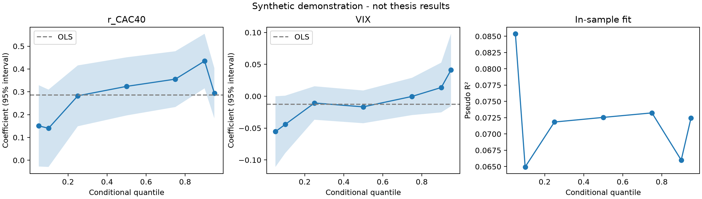

# Commodity quantile regression

**French equity–commodity dependence across market regimes**  
David Attias · ESCP master's thesis, 2025

How does the relationship between French equities and commodity returns change across the conditional return distribution? This research companion studies CAC40, S&P GSCI and VIX using quantile regressions, an autoregressive term and overlapping regime interactions, with OLS as a benchmark.

The submitted thesis is [Investigating French equity portfolio diversification with GSCI in the 21st century](reports/thesis.pdf). This repository consolidates the original CAC40 notebooks and distinguishes historical estimates from corrected timing. The report's conclusions remain historical claims; the original future-valued “lag” means they need reassessment before being used as evidence of autoregressive dependence.



*The figure above uses synthetic data. It demonstrates the software and makes no empirical claim about markets.*

## Start here

- [Offline quantile regression notebook](notebooks/01_quantile_regression_demo.ipynb): a self-contained synthetic demonstration.
- [Thesis snapshot notebook](notebooks/02_thesis_snapshot.ipynb): historical audit, corrected timing, and all three model specifications. Requires the local research snapshot.
- [Report/code reconciliation](docs/reconciliation.md): formulas, units, timing, discrepancies and interpretation limits.
- [Validation](docs/validation.md): executed checks and numerical comparison with historical exports.
- [Data guide](data/README.md): input schema and provenance.

## Run locally

From the repository root, using Python 3.11 or later:

```bash
python -m venv .venv
source .venv/bin/activate
python -m pip install -e '.[dev]'
python -m pytest -q
python scripts/run_analysis.py --mode demo
jupyter lab notebooks/01_quantile_regression_demo.ipynb
```

With your authorized local snapshot in `data/local/df3.csv`:

```bash
python scripts/run_analysis.py --mode historical
python scripts/run_analysis.py --mode corrected
python scripts/run_analysis.py --mode corrected --specification report_reduced
python scripts/run_analysis.py --mode corrected --specification notebook_reduced
```

Outputs include coefficient/p-value/95% interval tables, OLS summaries, pseudo R², iteration counts, warnings, sample dates, matrix rank and condition number, plus a summary plot. Quantile fits are computed once per run. Generated market results and the snapshot are excluded from Git by default.

## Research design

The full model is `r_GSCI ~ r_GSCI_lag + r_CAC40 + VIX + gamma1 + ... + gamma5`, where each interaction is the CAC40 return multiplied by a period indicator. Quantiles are 5%, 10%, 25%, 50%, 75%, 90% and 95%. Periods represent 2004–2013, 2008–2009, 2014–June 2017, January 2020–June 2022 and December 2021 onward. Exact boundaries and model variants are documented in the reconciliation.

This is an in-sample explanatory exercise. Same-day CAC40 returns and VIX are not assumed available at a prior trading decision. Pseudo R² is not a portfolio backtest or an out-of-sample performance measure. Cross-market closing-time differences and serial dependence remain research limitations.

## Repository map

```text
notebooks/              two consolidated workflows
src/commodity_qr/        shared preprocessing, estimation and exports
scripts/                command-line runner
reports/                submitted report and labeled historical tables
docs/                   reconciliation, validation and publication notes
data/local/             ignored local snapshot
results/                ignored generated output
assets/                 synthetic demonstration figure
```

## Attribution and publication status

Original thesis and research notebooks: David Attias. Academic references remain in the report, including Bianchi, Fan & Todorova (2020), Koenker & Bassett (1978), and Koenker & Machado (1999). The consolidated Python code is a later cleanup and correction of the 2025 work; it is not the code exactly as submitted.

This local package is awaiting the author's approval for GitHub upload. Permission to use the report for preparation was confirmed; its original confidentiality cover remains unchanged. No open-source license has been selected. See [publication notes](docs/publication.md).
